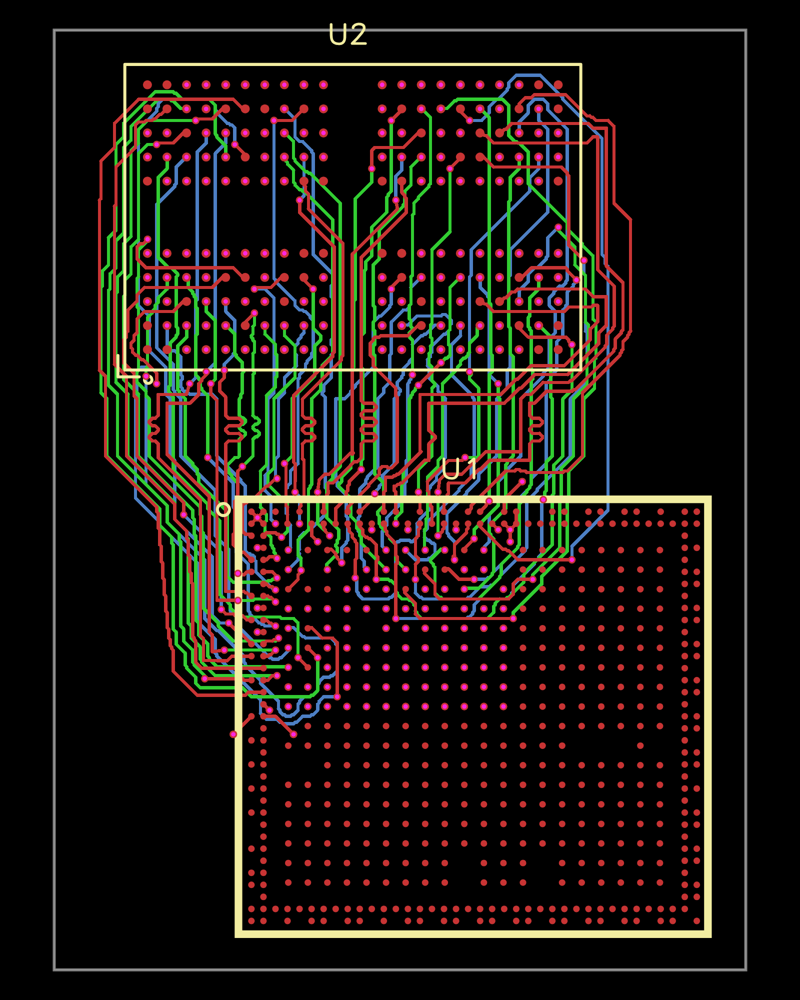

# RK3566 + LPDDR4 compute module (work in progress)

A 6-layer compute module built around the Rockchip RK3566 (U1, LCSC C2943786) and 2 GB of SK hynix
H9HCNNNBKUMLXR-NEE LPDDR4 (U2, LCSC C21912322).

**Status: not ready to order.** The memory interface between the processor and the LPDDR4 is routed and
verified. The rest of the module (schematic and netlist, power management, eMMC, connectors, the processor's
other signals, planes, board outline) is not designed yet. The outline in `index.circuit.json` only frames
the two packages and their copper.

## What is done

- All 67 LPDDR4 nets between U1 and U2 are routed (both channels: CA, CS, CKE, ODT, RESET, CK pairs,
  16 DQ, 2 DMI and 2 DQS pairs per channel). They run on three signal layers: top, inner3 and bottom.
- The power and ground balls of both packages are fanned out to their planes. Every ball whose
  neighbours leave room takes a filled via in its own pad; the 0.4 mm perimeter band of the RK3566 fans
  out to vias beside it, outside the strips the DDR breakout uses.

Results from `source/route/rk-check.ts`, in full in `source/route/check-results.txt`:

| Check | Result |
|---|---|
| Connectivity | 67 / 67 |
| Copper clearance at 0.10 mm (JLCPCB 6-layer minimum is 0.09 mm) | 0 issues |
| CK and DQS P/N mismatch (limit 12 mil) | 0.0 to 0.8 mil |
| CA/CS/CKE/ODT to CK (limit 500 mil) | worst 278 mil |
| DQ/DMI to DQS within a byte (limit 600 mil) | worst 485 mil |
| DQS to CK (limit 1200 mil) | worst 329 mil |
| Vias | 133 in total, 0 to 4 per net |

The limits are the LPDDR4 rules of Rockchip's RK356x high-speed PCB design guide (Table 33).

## Stackup

JLCPCB template **JLC06161H-1080A**, 1.6 mm, FR-4 TG155:

| Layer | Use | Dielectric to the next layer |
|---|---|---|
| L1 top | DDR signals, both BGAs | 1080 prepreg, 0.0764 mm, Er 3.91 |
| L2 (inner1) | ground | core 0.6 mm |
| L3 (inner2) | power | 3313 prepreg, 0.0994 mm, Er 4.1 |
| L4 (inner3) | DDR signals | core 0.6 mm |
| L5 (inner4) | ground | 1080 prepreg, 0.0764 mm |
| L6 bottom | DDR signals | |

All traces are 0.11 mm wide. A 2-D field solve gives about 53 ohm on the outer layers (a few ohms lower
under solder mask) and 52.5 ohm on inner3. CK and DQS pairs have a 0.18 mm gap, about 100 ohm
differential. Rockchip asks for 50 ohm single-ended and 100 ohm differential.

Vias are through vias, 0.15 mm hole and 0.25 mm pad. Many sit in pads, so order them epoxy-filled and capped;
JLCPCB fills via-in-pad free of charge on 6-layer boards.

## Open items before ordering

1. Schematic and netlist for every RK3566 ball: rails, boot straps, 24 MHz crystal, reset, debug UART
   and the interfaces brought out to the carrier.
2. Power: RK809 PMIC or discrete regulators, and the decoupling under both BGAs.
3. eMMC.
4. Board-to-board connectors (CM4 compatible).
5. Placement, routing of everything outside the DDR block, plane shapes, stitching vias and the board outline,
   then a full-board DRC.
6. Gerbers, drill, BOM and pick-and-place.

Eight balls in the power fanout are not supply rails: DDR_RZQ, ZQ0, DDR_VREFOUT, HDMI_TX_HPDIN,
SARADC_VIN0, SYSPLL_AVDD_0V9, SYSPLL_AVDD_1V8 and the USB_AVDD2 balls. Their vias are breakouts only. Each
needs its own part or rail (ZQ resistor, VREF capacitor, filtered analog supply), so the planes must not
connect to them.

## Files

- `index.circuit.json`: the board as tscircuit circuit JSON (rendered by `source/build.tsx`).
- `imports/`: the RK3566 and LPDDR4 footprints.
- `source/route/ddr.lane.routed.json`: the routed DDR traces, as produced by the negotiated-lane solver.
- `source/route/ddr.input.json`: the routing problem (pads, power fanout, buses and length rules).
- `source/route/power.fanout.json` and `power-fan-v5.ts`: the power fanout and the script that made it.
- `source/route/run-lane.ts`: the routing run. It uses `NegotiatedLaneSolver` from the bus-lanes-solver
  `feat/negotiated-lane-solver` branch with layers top, inner3 and bottom.
- `source/route/rk-check.ts`: the independent check (connectivity, DRC, Rockchip timing).
- `source/route/route.png`: the DDR block by layer (red top, green inner3, blue bottom, grey power fanout).

Rebuild the board JSON with `bun source/build.tsx`.
